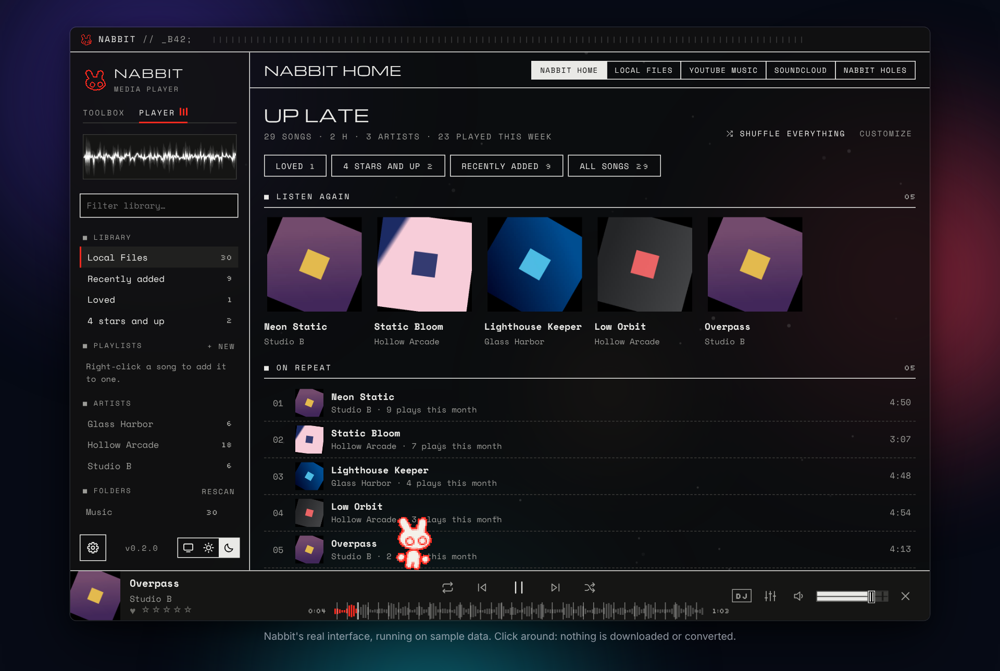
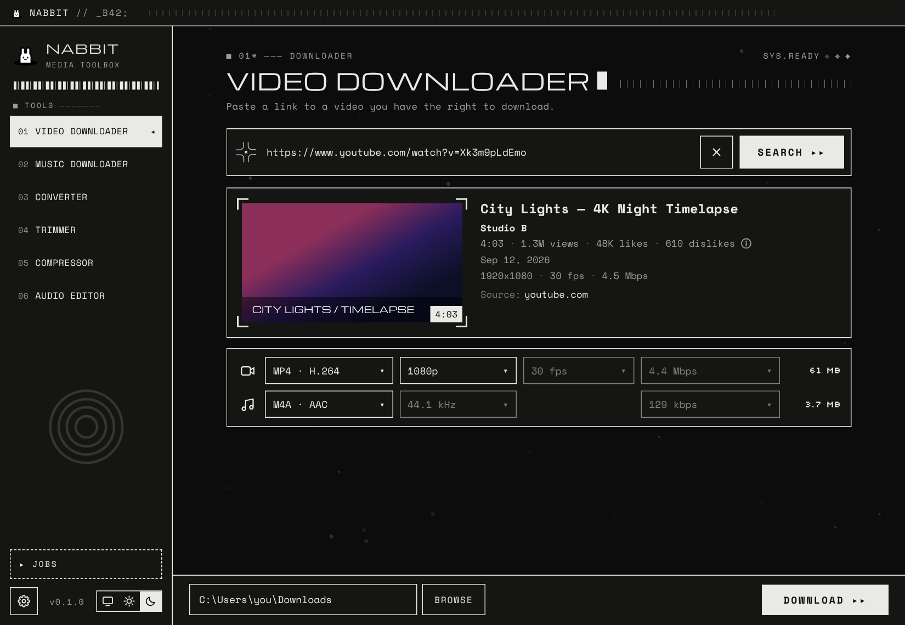
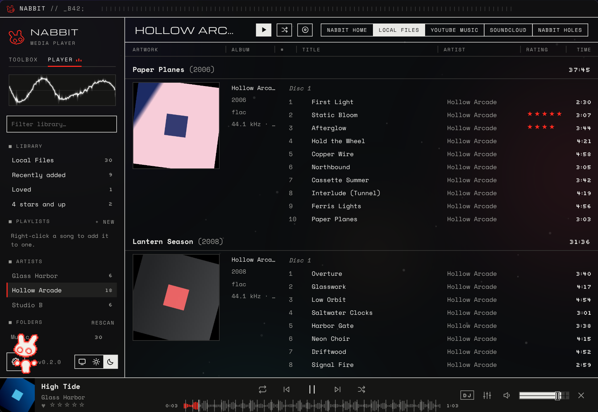
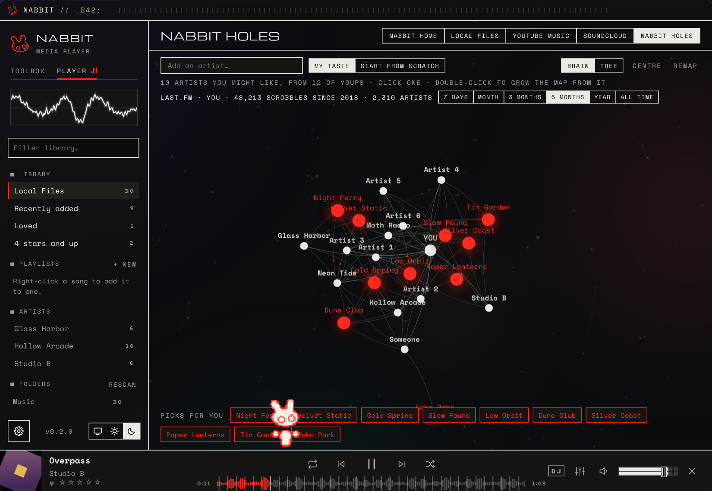
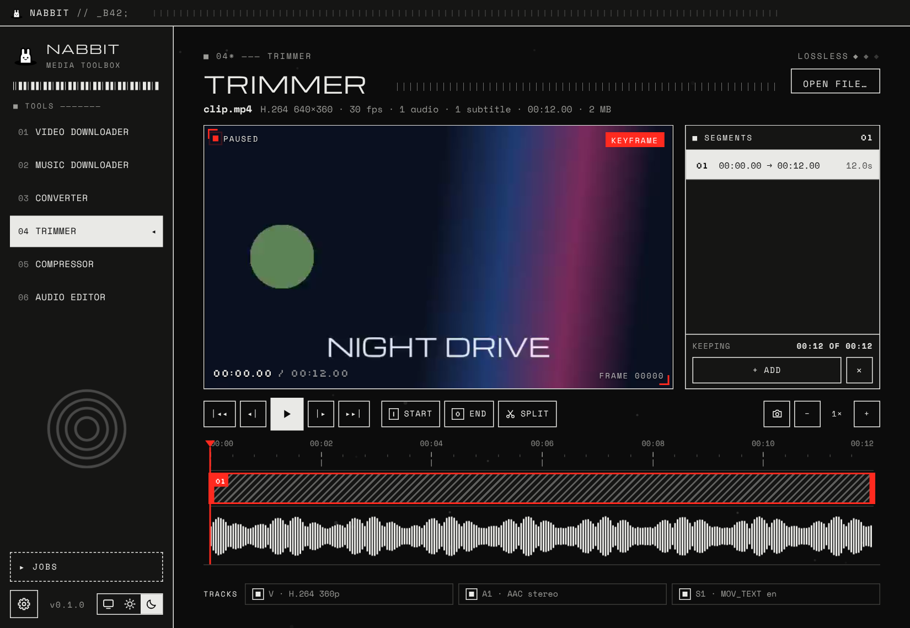
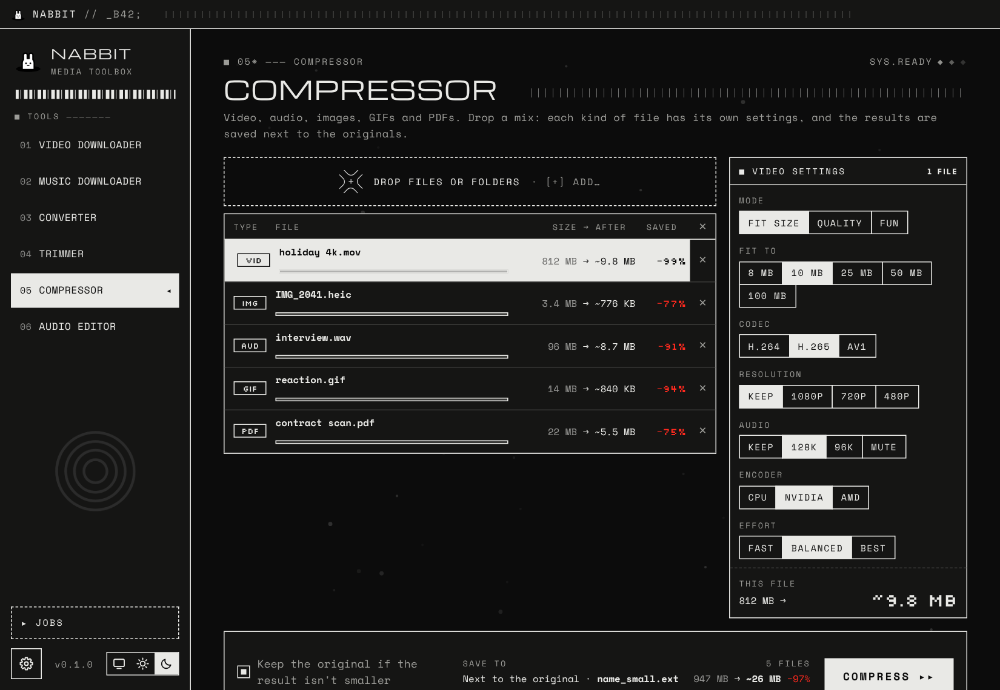
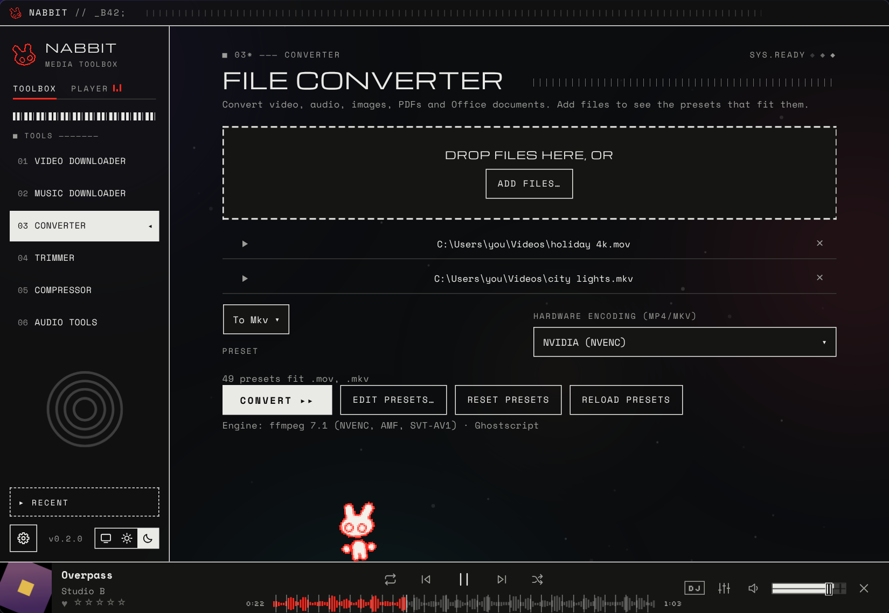
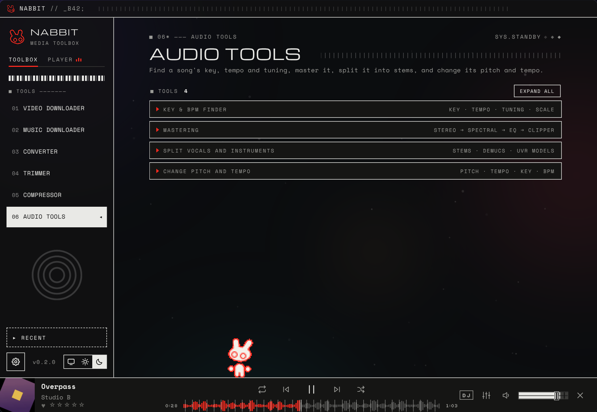
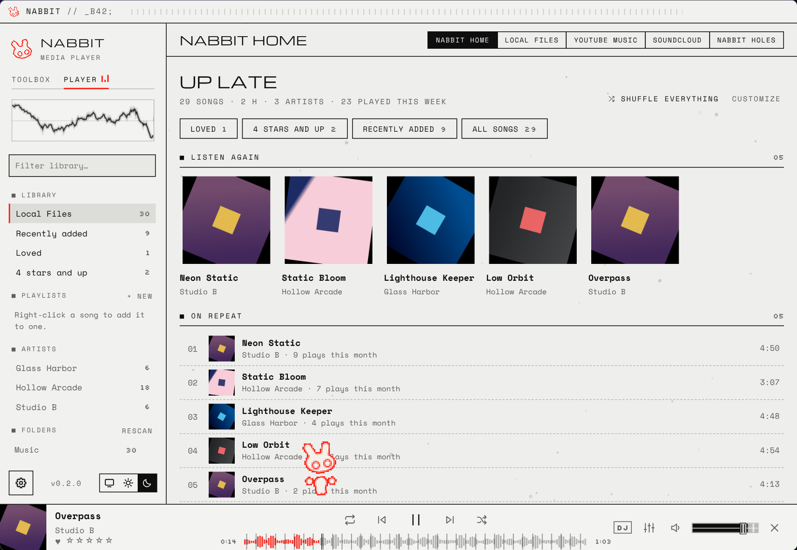

<div align="center">

# Nabbit

**Download, convert, trim and compress your media, all from one window.**

A media toolbox for Windows 10 and 11, built with Electron, ffmpeg and yt-dlp.



**[Try the interface in your browser →](https://n0lses.github.io/Nabbit/demo/)**

</div>

## Features

**Toolbox**

- **Video Downloader:** paste a link (or a batch of them), pick the format, resolution, frame rate and bitrate, and download.
- **Music Downloader:** search YouTube Music, SoundCloud or Soulseek for songs, albums, playlists and artists, preview them, and save the audio tagged with cover art and lyrics.
- **Converter:** video, audio, images, PDFs and Office documents, with dozens of presets (including audio → MIDI).
- **Trimmer:** cut and split video and audio without re-encoding, with a waveform timeline, keyframe snapping and smooth audio scrubbing.
- **Compressor:** shrink video, audio, images, GIFs and PDFs. Fit a video to a strict size such as 10 MB, or use Fun mode to deep-fry it.
- **Audio Tools:** find a song's key and BPM, master it, split it into stems, and change its pitch and tempo.

**Player**

- **Nabbit Home:** your own start page, with Listen again, On repeat and quick picks built from what you play.
- **Your library:** artists, albums, playlists, ratings and loved songs, with album pages and a *More albums* section.
- **Stream YouTube Music and SoundCloud** with your own account, and switch any song to its music video. Album versions are played before music videos.
- **Nabbit Holes:** a map of artists you might like, grown from your Last.fm history or from scratch. Search for an artist or right-click to add one.
- **Right-click any streamed song** to download it, find it on Soulseek, open its link, or go to its artist or album.
- **Discord status:** show what you're listening to, with your own customised Nabbit as the picture.
- **Back and forward** with the mouse side buttons, and a logo that dances to the beat.

**Everywhere else:** the File Explorer right-click menu (*Open In Trimmer*, *Compress*, *Convert to*), the [Firefox add-on](https://addons.mozilla.org/en-US/firefox/addon/nabbit/), a system tray icon, share links, and light and dark themes with Windows 11 blur.

## Screenshots

| Video Downloader | Music Downloader |
|---|---|
|  |  |
| **Library** | **Nabbit Holes** |
|  |  |
| **Trimmer** | **Compressor** |
|  |  |
| **Converter** | **Audio Tools** |
|  |  |
| **Light theme** | |
|  | |

## Getting started

You need [Node.js](https://nodejs.org) (LTS).

```bat
git clone https://github.com/N0lSES/Nabbit.git
cd Nabbit
npm install
npm run setup     :: downloads yt-dlp, Deno (yt-dlp needs it for YouTube), ffmpeg and Ghostscript
npm start
```

### Build the installer

```bat
build.bat
```

This runs the tests and builds `dist\Nabbit Setup <version>.exe`.

### Interface demo (GitHub Pages)

`docs/demo/` is the real interface running on sample data, so anyone can click through it in a browser. To publish it, open the repo's **Settings → Pages** and set **Source** to *Deploy from a branch*, **Branch** to `main`, and the folder to `/docs`. It goes live at `https://n0lses.github.io/Nabbit/demo/`. After changing the UI, run `npm run demo` to rebuild it, then commit.

## Documentation

The full guide covers every tool, the settings, the Explorer menu, the browser add-on, the converter engine and the project layout: **[docs/GUIDE.md](docs/GUIDE.md)**.

## License

[GPL-3.0-or-later](LICENSE). The converter engine is a JavaScript port of [File Converter](https://github.com/Th3Nekit/FileConverter) (GPL-3.0). It uses [yt-dlp](https://github.com/yt-dlp/yt-dlp) (with [Deno](https://deno.com), MIT, to read YouTube), [ffmpeg](https://ffmpeg.org) and [Ghostscript](https://www.ghostscript.com), each under its own license. The Michroma, Space Mono and Silkscreen fonts are under the SIL Open Font License.
