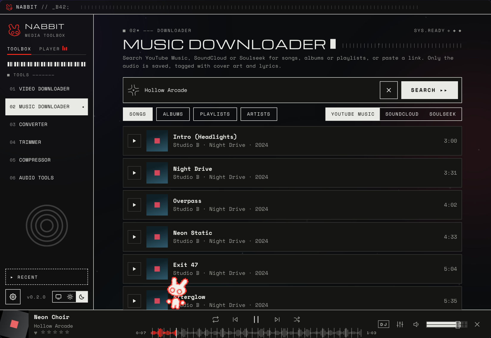
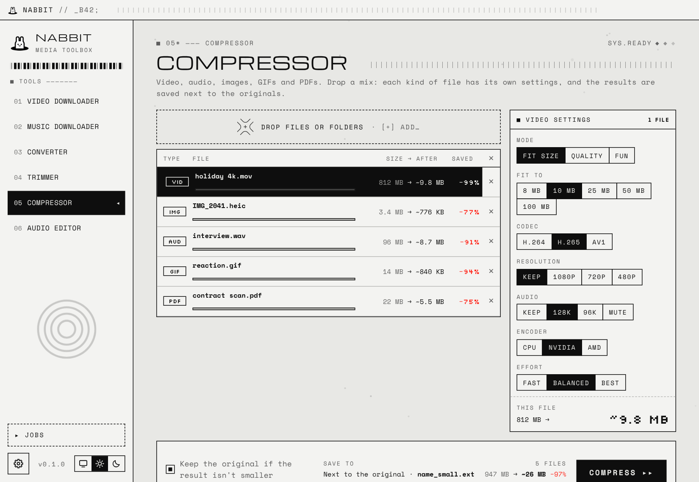

<div align="center">

# Nabbit

**Download, convert, trim and compress your media, all from one window.**

A media toolbox for Windows 10 and 11, built with Electron, ffmpeg and yt-dlp.


**[Try the interface in your browser →](https://n0lses.github.io/Nabbit/demo/)**

</div>

## Features

- **Video Downloader:** paste a link, pick the format, resolution, frame rate and bitrate, and download.
- **Music Downloader:** search YouTube Music or SoundCloud for songs, albums, playlists and artists, preview them in the built-in player, and save the audio tagged with cover art and lyrics.
- **Converter:** video, audio, images, PDFs and Office documents, with dozens of presets (including audio → MIDI).
- **Trimmer:** cut and split video and audio without re-encoding, with a waveform timeline, keyframe snapping and smooth audio scrubbing.
- **Compressor:** shrink video, audio, images, GIFs and PDFs. Fit a video to a strict size such as 10 MB, or use Fun mode to deep-fry it.
- **Everywhere else:** File Explorer right-click menu (*Open In Trimmer*, *Compress*, *Convert to*), a Firefox add-on, a system tray icon, and light and dark themes with Windows 11 blur.

## Screenshots

| Video Downloader | Music Downloader |
|---|---|
|  |  |
| **Trimmer** | **Compressor** |
|  |  |
| **Converter** | **Light theme** |
|  |  |

## Getting started

You need [Node.js](https://nodejs.org) (LTS).

```bat
git clone https://github.com/<you>/nabbit.git
cd nabbit
npm install
npm run setup     :: downloads yt-dlp, ffmpeg and Ghostscript
npm start
```

### Build the installer

```bat
build.bat
```

This runs the tests and builds `dist\Nabbit Setup <version>.exe`.


## Documentation

The full guide covers every tool, the settings, the Explorer menu, the browser add-on, the converter engine and the project layout: **[docs/GUIDE.md](docs/GUIDE.md)**.

## Responsible use

Only download content you own or have permission to download. Many sites' terms of service forbid downloading. Nabbit doesn't bypass DRM or paid streaming services.

## License

[GPL-3.0-or-later](LICENSE). The converter engine is a JavaScript port of [File Converter](https://github.com/Th3Nekit/FileConverter) (GPL-3.0). It uses [yt-dlp](https://github.com/yt-dlp/yt-dlp), [ffmpeg](https://ffmpeg.org) and [Ghostscript](https://www.ghostscript.com), each under its own license. The Michroma, Space Mono and Silkscreen fonts are under the SIL Open Font License.
